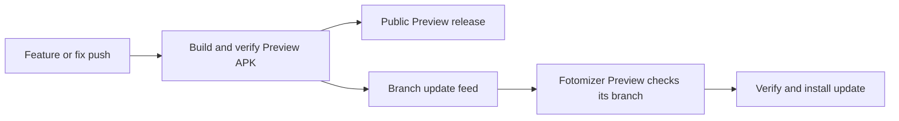

<h1 align="center">Fotomizer Preview</h1>

Try upcoming photo-editing changes before the official release.

<a href="https://github.com/dabestakoh/fotomizer-previews/releases">Download Preview builds</a> · <a href="https://github.com/dabestakoh/fotomizer-releases/releases/latest">Get official Fotomizer</a> · <a href="https://github.com/dabestakoh/fotomizer-releases/issues/new/choose">Report a problem</a>

## A separate app for testing

**Fotomizer Preview** installs beside official **Fotomizer** on Android 10 or newer. It has its own settings, recipes and creations, so you can try feature and fix builds while keeping the regular app installed.

Use it to test upcoming editor, collage, crop and workflow changes. Each build's short release notes describe what changed. Preview builds may contain unfinished behavior; choose the branch relevant to the feature or fix you are testing.

## Download and install

1. Open [Preview releases](https://github.com/dabestakoh/fotomizer-previews/releases).
2. Choose a build for the branch you want to test and download its `Fotomizer-<version>.apk` asset. Public downloads do not require a GitHub account.
3. Allow installation from your browser when Android asks, then install the APK.
4. Look for **Fotomizer Preview** in your launcher. Keep official Fotomizer installed.

All branches share one Preview app identity. Installing a newer build from another branch switches that Preview installation to the other branch. Never uninstall or clear app data to force an update. Preview and official Fotomizer have separate app data, but both can access the same photo library if you grant permission: use generic test photos.

## Preview updates

The app follows the update feed for its installed branch. A newer build is offered through the existing in-app update controls; the app verifies package, version, SHA-256 and its existing Preview signing identity before installation. Android asks you to confirm installation.

Official Fotomizer continues using [fotomizer-releases](https://github.com/dabestakoh/fotomizer-releases). Frequent Preview builds and their feeds live here, separately from official downloads.

## Identify your build

Versions look like `1.4.10-preview.12.1.a1b2c3d4`: source version, workflow run, attempt and short commit. Release titles identify the branch; `updates-preview.json` records the full commit, versionCode, APK size and checksum. Android updates are ordered by versionCode. Keep the same Preview signing identity and install newer builds over older ones to retain Preview data.

The repository also contains generated `preview-<channel>` branches holding update metadata. They are download feeds, not application source. APKs and metadata are published as immutable prereleases.

## Moving from earlier Preview builds

Earlier Preview builds checked the official releases repository. Its final transition Preview switches subsequent checks to this repository, using the same package and test signing key. You can also install a newer Preview APK from here directly over the old Preview app.

## Share useful feedback

Include your Preview version, branch, Android version, steps to reproduce, expected result and actual result in a [bug report](https://github.com/dabestakoh/fotomizer-releases/issues/new/choose). Use generic or redacted screenshots. Keep credentials, personal photos and private diagnostic logs out of public issues.

Application source remains private. Signing keys and publishing credentials are not stored in this repository. Preview releases are test builds and are separate from official stable updates.